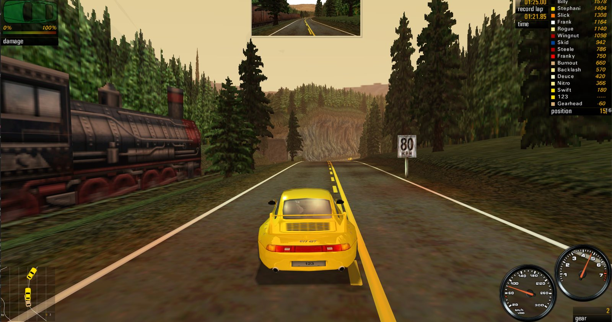
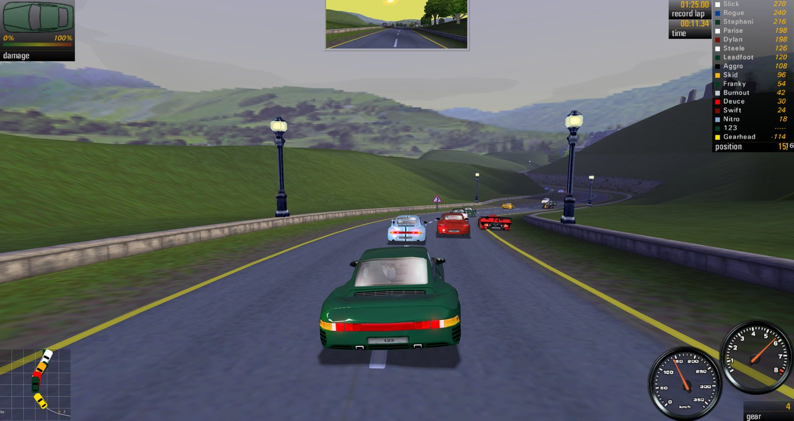
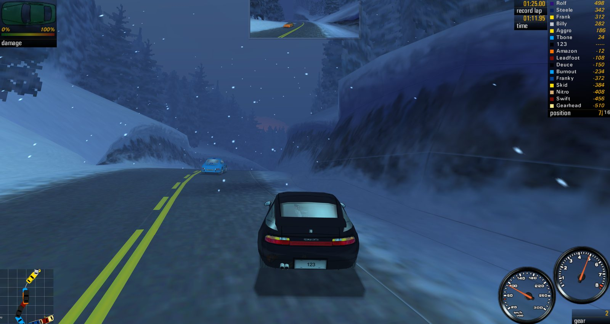
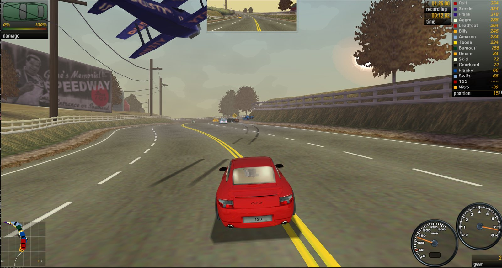
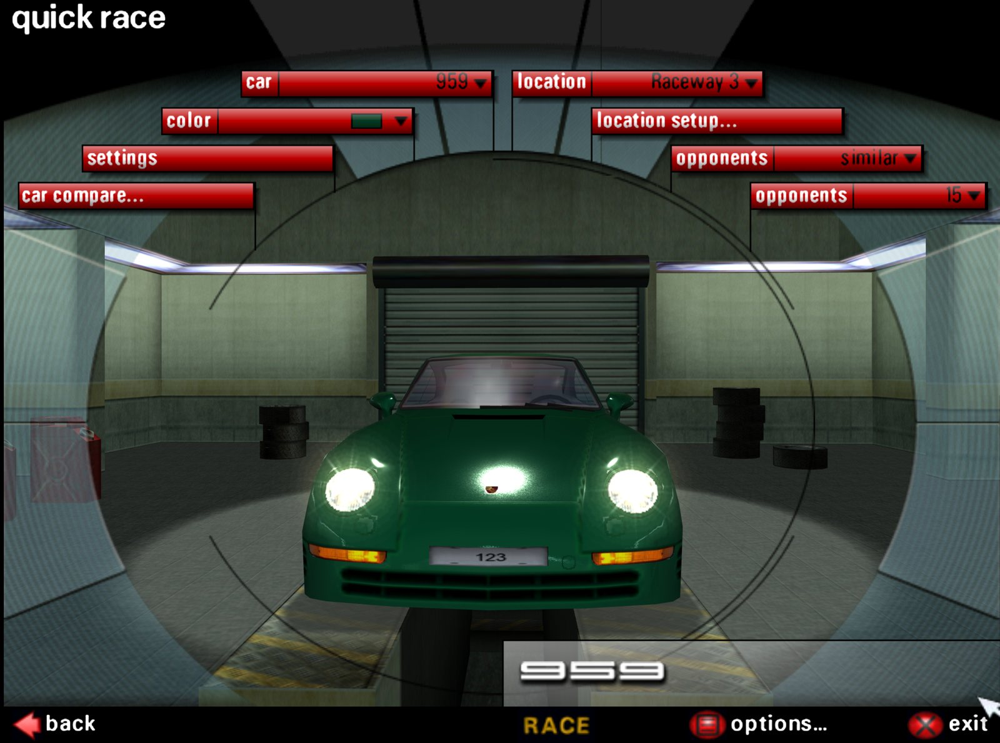

# Need for Speed: Porsche Unleashed in the browser

<p align="center">
  <a href="https://nfs5-reforged.duckdns.org/"><b>&#9654;&nbsp; PLAY IN THE BROWSER &nbsp;&mdash;&nbsp; nfs5-reforged.duckdns.org</b></a>
  <br>
  <sub>Chrome, Edge or Safari on a PC, Mac, Android phone, iPhone or iPad. No install; play as a guest or with an account.</sub>
</p>

<p align="center">
  <a href="https://nfs5-reforged.duckdns.org/"></a>
</p>

<table>
  <tr>
    <td width="50%"></td>
    <td width="50%"></td>
  </tr>
  <tr>
    <td width="50%"></td>
    <td width="50%"></td>
  </tr>
</table>

A fan project that runs the PC game *Need for Speed: Porsche Unleashed* (2000) in the browser, with the
NFS5 Reforged features, tracks converted from *Need for Speed: High Stakes*, and online races. The game's x86 code
is translated to C ahead of time and compiled to WebAssembly; the game's THRASH renderer runs on WebGPU, the sound
on Web Audio.

## Features

> Everything below is added to the stock game. The technical list, with the game functions each one hooks and how it
> was checked, is [docs/FEATURES.md](docs/FEATURES.md).

### Tracks and races
- **The 19 *Need for Speed: High Stakes* tracks**, converted to Porsche Unleashed, with their official names.
- Walls and roadside-object collisions on them with the game's own impacts, animated objects and textures, the sky
  and horizon, and their ambient sounds.
- AI tuned for the converted tracks: speed limits per corner, ramps, recovery when a car is stuck.
- **Quick Race with up to 15 opponents**: 16 cars on the grid instead of 8.
- **"Similar cars" and "similar tuned" opponents** in Quick Race.

### Online and saves
- **Online instead of network play**: one click from the main menu to a lobby with chat, inside the game's own menus.
- Race modes: races between players, races with bots filling the grid, and **career tournaments** whose points,
  prizes and progress count in your own career.
- **Accounts with cloud saves**: your career follows you to any device; the newer save wins, the older one is kept as
  a backup and can be downloaded.
- **Play as a guest** without an account; an account made later takes the guest's saves along.

### Picture
- **Any screen shape from 4:3 to 32:9** with a Hor+ camera; the race is drawn at the window's real pixels, up to
  2160 lines, and follows a resized window live.
- **Frame interpolation**: the race is drawn at the display's rate (120 Hz and more) instead of the game's 64 steps
  a second.
- **Car paint on every car**: a metallic base with flakes, a clear coat with an orange-peel ripple, sun glints, and a
  paint mask so seams, grilles, badges and plates stay matte.
- **Live reflections**: a cube map of the scene around the car, and a separate one in the showroom.
- The garage-quality car models in races, **twice the draw distance**, distant wheels.
- Sharp menu and HUD text, the HUD scaled to the screen, the highest texture detail, **MSAA x4**.
- **A light profile on phones and tablets**: the game's own car models and draw distance, cheaper reflections, up to
  720 lines without MSAA; a race frame costs about a third.

### Controls and sound
- **Gamepads** with the standard layout in menus and races, with **rumble** on impacts.
- **Touch controls** on phones and tablets: steering stick, gas, brake, hand brake, gears, camera, look back, reset,
  pause; vibration on impacts; full screen and landscape on the first touch.
- **Low-latency sound** through an AudioWorklet, without breaks while a track loads.

### Fixes
- An exact game timer: a steady 64 simulation steps a second, no lost ticks.
- Car-to-car hits no longer hook a car sideways.
- The CPU speed check no longer misreads fast processors.
- Crashes of the 16-car races fixed (roadside objects, the lap line).

> Not affiliated with or endorsed by Electronic Arts. This repository contains none of the game's code or data:
> no EXE, no DLL, no game files, no lifted C, no compiled module. All of that is made locally from your own copy.

Built after [nfsu2-web](https://github.com/th0mk/nfsu2-web) (MIT), the browser port of NFS Underground 2, whose
lifter this repository started from (`licenses/`).

## What you need

- **The game:** your own English PC copy of *Porsche Unleashed* with the official **v3.5** update. The build takes
  the update's `Porsche.exe` (or the update archive `nfspu_v35.zip` itself): 2,129,965 bytes, SHA-256
  `e4684948ca9bfb552a0fc0eeb7024a13bfe67f2e40ebb6ba121ae6a81dd166bb`. Other versions will not work: every
  address in this project is from that build.
- **To build (Windows):** Python 3 with `pip install -r requirements.txt`, Git Bash, and clang — the one that
  ships with Visual Studio 2026 (component "C++ Clang tools") works for both targets. The browser build will
  also need [wasi-sdk](https://github.com/WebAssembly/wasi-sdk/releases) (Windows release) in `deps/`.

## Build

```sh
pip install -r requirements.txt
./gen.sh "/path/to/nfspu_v35.zip"     # patch a copy of the EXE, translate it to C (into gen/)
./build.sh                            # compile check, native x64   (out/obj)
TARGET=wasm ./build.sh                # compile check, wasm32       (out/wobj)
```

`gen.sh` checks the EXE, applies `patches/exe_v35.txt` to a copy (`out/PORSCHE.EXE`; your file is never
changed) and lifts it: 8,711 functions, 0 missing callees, ~50 MB of C.

## Run it in the browser

Needs [wasi-sdk](https://github.com/WebAssembly/wasi-sdk/releases) in `deps/`, Node.js, a browser with WebGPU (Chrome)
and an installed copy of the game (default `M:/Games/nfs5_clean`, or `--data <folder>`).

```sh
./gen.sh "/path/to/nfspu_v35.zip"     # once
./web/build.sh                        # the module, out/web/nfs5.wasm
run_web.bat --data "C:/Games/Porsche" # builds the page, starts the server, opens http://127.0.0.1:8077/
```

Saves live in the browser's own storage (OPFS) of that address. The server takes `--port` and `--password`.

## How it works

- **`tools/`:** a Python lifter (Capstone) turns every function of `PORSCHE.EXE` into C over a `CPU` struct.
  Guest addresses are wasm linear-memory addresses, so the game's globals sit where they sit on Windows.
- **`patches/`:** byte patches applied to the EXE before lifting (ours; byte values only).
- **`runtime/`**: Windows, DirectSound, DirectInput 5 and the THRASH renderer reimplemented, the
  browser parts in `runtime/web/`.
- **`web/`**: the page (game threads as workers on one shared memory, WebGPU, AudioWorklet) and the
  server (password-protected; serves the page, the module and your game folder; WebSocket bridge for online play).

More: [docs/ARCHITECTURE.md](docs/ARCHITECTURE.md).

## Credits

The static recompilation method and the lifter come from Talha Müderrisoğlu's
[NFSU2Recomp](https://github.com/TalhaMudo/NFSU2Recomp) and th0mk's [nfsu2-web](https://github.com/th0mk/nfsu2-web),
which follow [N64: Recompiled](https://github.com/N64Recomp/N64Recomp) and
[XenonRecomp](https://github.com/hedge-dev/XenonRecomp). Built with the help of Claude Code.

## License

MIT, see [LICENSE](LICENSE). The game itself is Electronic Arts' and is not part of this repository.
